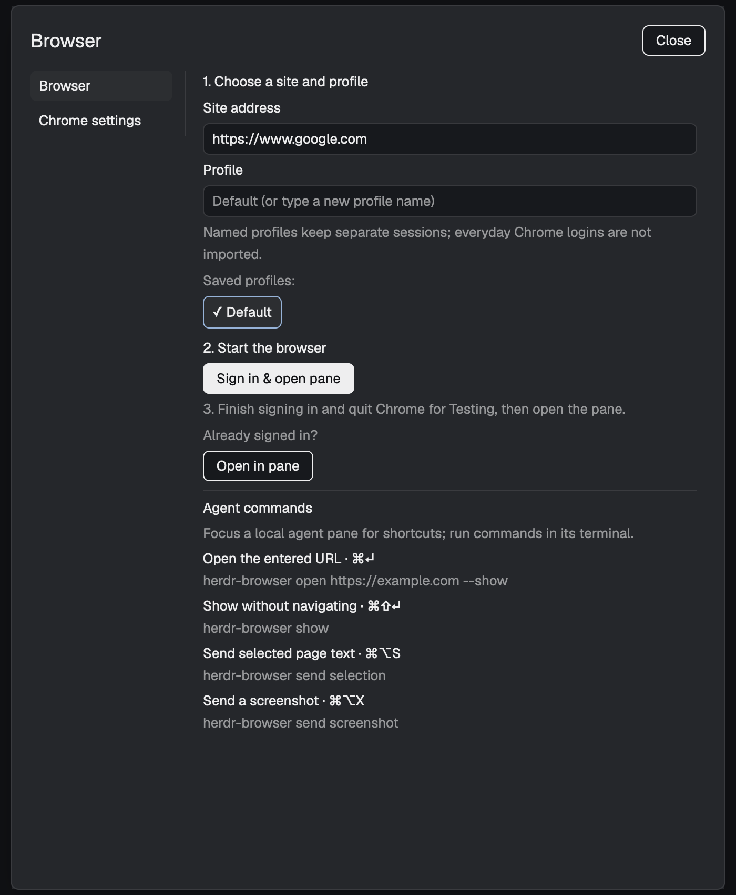

# Herdr Browser

Open a Browser dialog in Herdr Desktop to choose a site and a dedicated Chrome profile, then open a live browser to the right of your terminal. Sign in yourself when you need a session, or open the browser directly. From a local agent pane, the dialog also shows shortcuts and terminal commands for opening that agent’s browser and sending it a selection or screenshot.

## What you see

- **Header:** a 680 × 840 dialog with 18 px padding, a theme `popover` background, and 13 px `foreground` text. An 18 px semibold **Browser** title sits opposite **Close**.
- **Left rail:** a 148 px column with a `border` divider and two destinations: **Browser** and **Chrome settings**. The selected row uses `raised` and semibold text; rows use `hover` on pointer-over.
- **Browser page:** a vertically scrollable column. **Choose a site and profile** has two 30 px inputs, a muted note about separate sessions, and a horizontally scrolling strip of named profile chips beside **Default**. A selected chip has a checkmark, `accent` border, and `raised` fill. Below are the solid **Sign in & open pane** button, muted sign-in instructions, the outlined **Open in pane** button, and four **Agent commands** rows with their configured shortcut labels and CLI forms.
- **Chrome settings:** the same header and rail, with the selected profile name, **Install Chrome for Testing**, and **Stop Chrome for this profile**. The body shows muted progress or results and uses the theme’s `blocked` color for warnings and errors. These are Browser states, not agent statuses: there are no working, blocked, done, or idle agent badges.

## How it behaves

1. Open **Browser** from a local terminal pane. **Close** dismisses the dialog; the left rail switches pages in place. The site starts at Google. Choose **Default**, click a saved profile, or type a new name. Profile chips and buttons highlight on hover. The dialog remembers a clicked profile or one used to open a pane or successfully run an agent action.
2. **Sign in & open pane** requests a standalone right split and starts a manual Chrome for Testing window for the chosen profile and site. Sign in, then quit Chrome for Testing so the split can start its live view. **Open in pane** skips manual sign-in. Both close the dialog once the split request succeeds; startup errors appear in the pane. **+ → Browser** instead starts a standalone view with the default profile in its own terminal. Neither standalone route can send to an agent.
3. From a uniquely displayed local agent, the Browser page’s default shortcuts are **Cmd–Enter** to open the entered URL beside that agent (show without navigating if empty), **Cmd–Shift–Enter** to show or reuse its view, **Cmd–Option–S** to send selected text, and **Cmd–Option–X** to send a screenshot. Open and show close the dialog after success; sends keep it open and show the helper’s result. Changing focus cannot retarget the action.
4. In the live view, click the address bar or press **Ctrl–L**, enter an address, and press **Enter**. The toolbar handles back, forward, reload, zoom, find, browser tabs, bookmarks, search settings, and files. **Close pane** or **Ctrl–Q** exits the view without stopping Chrome. Use **Chrome settings** to stop only the selected profile or open a separate **Install Chrome** tab to provision the browser.

## Built from

- Start with `mods/herdr-browser/main.js`, `mod.json`, and the 16 × 16 `currentColor` globe `icon.svg` used for the launcher. Set `place: "none"`, `focusable: true`, `title: "Browser"`, and `overlay: { "kind": "dialog", "width": 680, "height": 840 }`. Build a `gpui-kit` `View` with `gpui-base` flex, input, and button controls. Use `theme()` for the palette, `props().overlay` with `closeOverlay()` to dismiss, and `shared()` / `setShared()` with `herdr-browser.profile` for the selected profile. There are no layout nodes, shipped layout files, or other mod dependencies. Generated app typings are not runtime files.
- Capture the launch terminal, pane, and tab with `focused()`, `panes()`, and `spaces()`; match `agents()` to that same placement for agent actions. With `exec`, invoke the absolute `~/.local/bin/herdr-browser` path as separate arguments. Load profiles on dialog initialization with `--json profiles`, not during render or check. For standalone splits, pass `HERDR_APP_HOME` from `appHome()` and call `herdr-app do pane.split` with the exact pane, `direction: "right"`, and helper argv: optional `--profile NAME`, then `view --standalone`, optional `--url URL`, and `--sign-in` only for manual sign-in. Settings uses `run("tab.new", …)` for `install-browser` and the helper’s `stop` for the selected profile.
- Open the overlay with `herdr-app do mod.open --name herdr-browser`. To set keys manually, merge the optional `keys.json` snippet without replacing existing bindings. It proposes global Cmd–Option–B; the installer instead tries Cmd–Shift–B first, then Cmd–Option–B. Use the `mod:herdr-browser` actions `herdr-browser.open`, `herdr-browser.show`, `herdr-browser.selection`, and `herdr-browser.screenshot`. Dispatch them through `nextCommand()` on the Browser page and derive displayed labels from `keys()`. Invoke the helper with `--owner ADDRESS` and optional `--profile NAME`, followed by `open URL --show`, `show`, `send selection`, or `send screenshot`. The `programs.herdr-browser` launcher runs the absolute helper with `view --standalone` and uses `mods/herdr-browser/icon.svg`.
- Use the bundled Rust helper, not an upstream executable. It validates the exact address with `hc get`, matches the owner’s desktop placement using `herdr-app ls`, and requests or reuses an owned split with `pane.split`. CLI ownership comes from `--owner` or `HC_TERMINAL_ID`; use the same `--profile` on related calls. The helper supplies terminal rendering and page operations (`snapshot`, `click`, `type`, `text`, `screenshot`, `console`, `network`, `back`, `reload`). It sends only to the validated originating agent via `hc send`, without `--force`.
- Adapted from [Matt Coles’s herdr-web-browser](https://github.com/MattJColes/herdr-web-browser), [release 1.3.3](https://github.com/MattJColes/herdr-web-browser/releases/tag/v1.3.3), pinned at [3e648606e2d06a03ac3a3388ae468698e53619c5](https://github.com/MattJColes/herdr-web-browser/tree/3e648606e2d06a03ac3a3388ae468698e53619c5). Keep the upstream MIT notice, `Copyright (c) 2026 Matt Coles`, in [LICENSE](LICENSE) and with the installed files. This version uses Herdr Desktop and herdr-core, not the Herdr TUI.

## Watch out

- Read the package before installing. It runs local programs through `exec`, `herdr-app`, and `hc`; downloads Chrome for Testing; accesses sites over the network; and reads and writes dedicated state and files outside the mod folder. Use trusted previews. The HTTP(S) console/network recorder is not a tamper-proof log.
- Installation requires Rust/Cargo, Python 3, `hc`, and `herdr-app`. Use the bundled `scripts/install` to install the helper, recorder, license, desktop mod, and OMP skill; provision Chrome separately with `~/.local/bin/herdr-browser install-browser` or the settings button. Preserve occupied shortcuts and unrelated settings. If neither launcher shortcut is available, use the named command. Don’t install a layout or copy the recipe and preview into the mod directory.
- Profile names are 1–64 lowercase letters, digits, hyphens, or underscores; blank means default. Under `${XDG_STATE_HOME:-$HOME/.local/state}/herdr-browser`, Chrome uses `profile` for default and `profiles/<name>/profile` for named sessions. Sign-in never imports ordinary Chrome cookies or the keychain. Stop a running profile explicitly before manual sign-in. Agents authorized to use a signed-in profile can access its session; separate page ownership does not separate cookies within a shared profile.
- Refuse remote, stale, or ambiguous placement rather than borrowing focus or opening remote localhost on this Mac. A shell can launch a standalone pane but is not an agent recipient. A successful navigation, a requested split, and a successful send are separate outcomes; don’t report a page rendered merely because the split was requested. Surface helper errors and send refusals.

## Done when

1. The Browser dialog matches the preview: title and Close, two-page rail, selected profile chip, both standalone launch buttons, and four Agent commands rows with the shortcuts actually bound. Chrome settings shows the selected profile and its install and stop actions.
2. Opening from a local terminal makes a right-hand browser pane without changing layouts. Direct launch renders the entered site; manual sign-in starts the live view after the dedicated Chrome window quits. The plus-menu Browser opens independently, with no agent recipient.
3. Opening and showing from the same local agent and profile reuse its live split; show alone leaves the page unchanged. A selection and a readable screenshot reach only that agent. Remote or stale placement, an empty selection, or a refused send does not report success.
